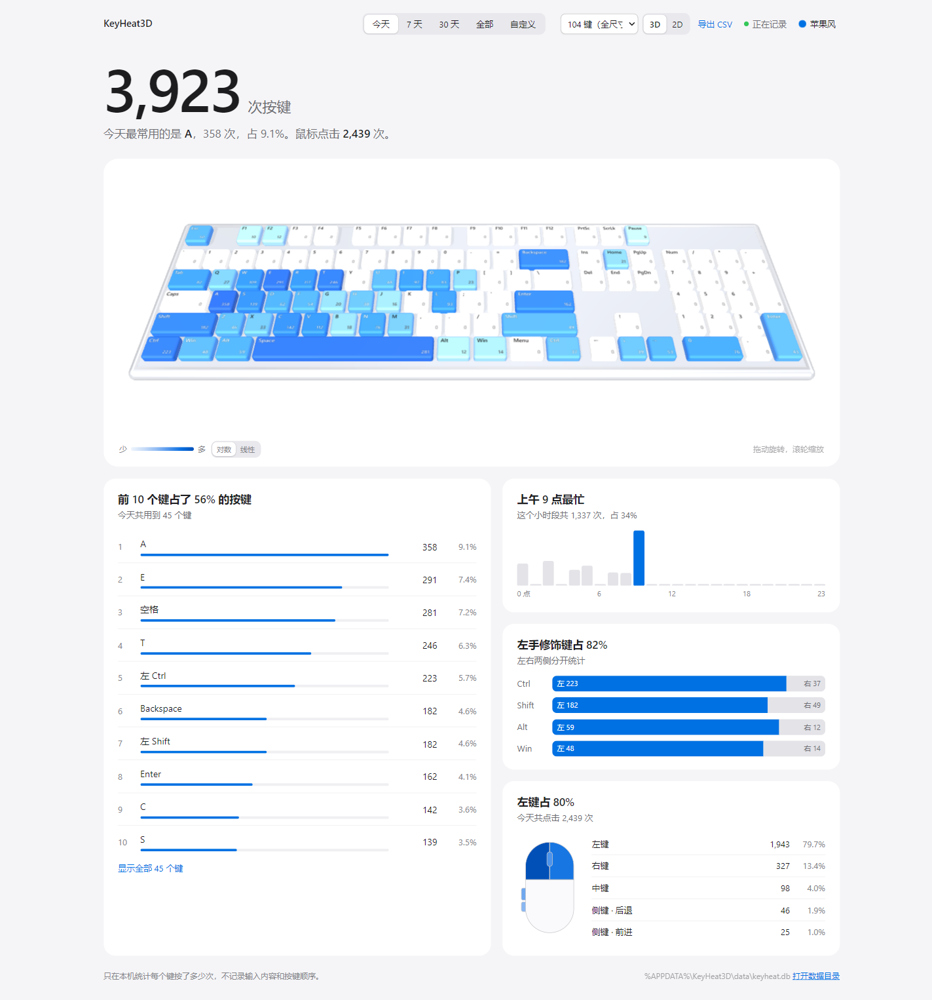

# KeyHeat3D

[简体中文](README.md)

KeyHeat3D is a Windows desktop app that shows how often you use each key and mouse button. Explore your activity as an interactive 3D keyboard or a flat 2D heatmap. The app interface is in Simplified Chinese.

## Download

Download the portable Windows x64 EXE and double-click it to run. [GitHub Releases](https://github.com/ShepiTT/KeyHeat3D/releases/latest)

[](docs/screenshots/README.md)

[View all nine themes in 3D and 2D](docs/screenshots/README.md)

## Features

- Nine themes with distinct 3D keycap materials and matching 2D views. Choose Apple-inspired, Glass, Widgets, Paper & Ink, Pixel, Cyberpunk, Win9x, Clay, or LCD, and pair any theme with one of eight accent colors.
- Five keyboard layouts (104-key, TKL, 75%, 65%, and 60%) with counts on the keycaps. Rotate and zoom in 3D, or switch to 2D.
- Separate counts for left and right modifier keys and for all five mouse buttons. Holding a key counts as one press.
- Date filters, linear and logarithmic heat scales, key rankings, and a 24-hour activity chart. Hover over a key to see its count, share, and rank.
- Export hourly counts as CSV. Close the window to keep counting in the system tray, where you can reopen the app, pause counting, save, or quit.

## Privacy

KeyHeat3D works offline. The only fields it records are the hour, the key or mouse button, and the count. The portable version stores this SQLite database at `%APPDATA%\KeyHeat3D\data\keyheat.db`. When running from source, the database is at `data/keyheat.db` in the project folder.

## Run from source

The Windows build was tested with Node.js 22 and npm. [Node.js downloads](https://nodejs.org/en/download)

```powershell
git clone https://github.com/ShepiTT/KeyHeat3D.git
cd KeyHeat3D
npm ci
npm start
```

Run `npm run dist` to build the portable EXE in `dist\`. Run `npm start -- --hidden` to start in the system tray.

## License

KeyHeat3D is licensed under the MIT License. The portable build includes libuiohook under LGPL-3.0-or-later. See the third-party notices for license texts, corresponding source, and rebuild instructions. [MIT License](LICENSE) · [Third-party notices](THIRD_PARTY_NOTICES.md)
