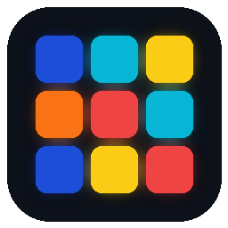
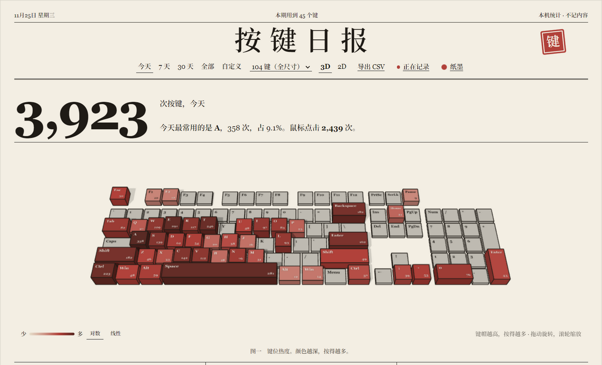
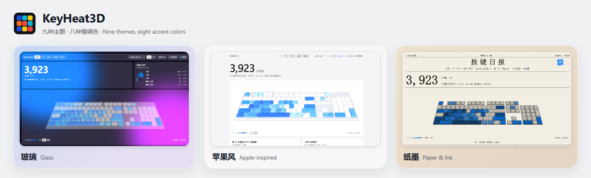

<div align="center">
  
  <h1>按键热力图 · KeyHeat3D</h1>
  <p>看看你最常按哪些键。</p>
  <p>Windows 免安装 · 3D 与 2D 热力图 · 九种主题 · 本地统计</p>
  <p>
    <a href="https://github.com/ShepiTT/KeyHeat3D/releases/latest">下载最新版</a> ·
    <a href="#界面预览">看界面</a> ·
    <a href="#运行">本地运行</a> ·
    <a href="#隐私">隐私</a>
  </p>
  <p><a href="README.en.md">🌐 English</a></p>
</div>

[](docs/screenshots/README.md)

示例画面中，今天按了 3,923 次键，最常按的是 **A**。

在 Windows 本地统计键盘和鼠标各键的使用次数，用 **3D 键盘** 或 **2D 热力图** 展示。

## 下载

在 [GitHub Releases](https://github.com/ShepiTT/KeyHeat3D/releases/latest) 下载 Windows x64 免安装 EXE，双击运行。

## 界面预览

[](docs/screenshots/README.md)

[查看九种主题的 3D 与 2D 截图](docs/screenshots/README.md)

## 功能

- 在后台分别累计每个键的按下次数，左右 `Ctrl` / `Shift` / `Alt` / `Win` 分开计数
- 长按产生的自动连发会去重，一次物理按下只算一次
- 统计鼠标左键、右键、中键和两个侧键
- 可选布局：104 键、87 键（TKL）、75%、65%、60%
  - 65% 和 60% 左上角的 Esc / ` 键合并显示
  - 当前布局里没有的键（比如用 60% 布局时按的方向键）仍会计数，排名列表中会标出「当前布局未显示」
- 3D 视图：常用键的键帽更高，帽面颜色对应图例。可拖动旋转、用滚轮缩放，键帽材质和按下反馈随主题变化
- 2D 视图：平面热力图，适合截图
- 九种主题：苹果风、玻璃、小组件、纸墨、像素、赛博朋克、千禧、黏土、液晶。每种主题都有默认配色，也可以选用一种强调色统一覆盖所有主题
- 色阶可在对数和线性之间切换（对数能让少用的键也看得出差别）
- 时间范围：今天、最近 7 天、最近 30 天、全部、自定义日期
- 悬停任意键可以看次数、占比和排名；侧栏有键盘和鼠标的排名，以及 24 小时分布
- 导出 CSV（按「小时 × 按键」，带 BOM，Excel 打开不乱码）
- 关闭窗口后最小化到托盘继续采集；托盘菜单可以暂停采集、立即保存、完全退出

## 隐私

- 只保存「某个小时内某个键按了几次」，**不记录输入内容、按键顺序、窗口或应用**
- 不联网，数据只存在本机
- 数据文件：开发运行时在 `data/keyheat.db`；打包后在 `%APPDATA%\KeyHeat3D\data\keyheat.db`。删除这个文件就会清空数据

## 运行

1. 安装 [Node.js LTS](https://nodejs.org/)（20 或更新版本）
2. 在本目录打开终端：

   ```powershell
   git clone https://github.com/ShepiTT/KeyHeat3D.git
   cd KeyHeat3D
   npm ci
   npm start
   ```

   如果安装依赖时下载 Electron 很慢，可以先设置镜像：

   ```powershell
   $env:ELECTRON_MIRROR="https://npmmirror.com/mirrors/electron/"
   npm ci
   ```

3. 打包成免安装的 exe（输出在 `dist\`）：

   ```powershell
   npm run dist
   ```

启动参数 `--hidden` 可以不弹出主窗口、直接在托盘运行。

## 注意

- 以管理员权限运行的程序（包括部分游戏）里的按键，需要用管理员身份启动 KeyHeat3D 才能统计到
- 使用反作弊或独占输入的游戏可能完全收不到按键，本程序不会尝试绕过
- 数据每 60 秒自动保存一次，退出时也会保存。强制结束进程最多丢失最近 1 分钟

## 目录结构

```
KeyHeat3D/
├── assets/icon.png        程序和托盘图标
├── src/
│   ├── main/
│   │   ├── main.js        主进程：窗口、托盘、IPC、CSV 导出
│   │   ├── capture.js     全局按键采集与去重（uiohook-napi）
│   │   ├── store.js       SQLite 存储（sql.js）
│   │   └── preload.js     给界面开放的安全接口
│   ├── renderer/
│   │   ├── index.html
│   │   ├── styles.css
│   │   ├── app.js         3D / 2D 热力图、排名、时间范围
│   │   ├── themes/        界面模板、3D 材质和主题色阶
│   │   └── fonts/         本地字体与许可
│   └── shared/
│       └── layouts.js     各尺寸键盘布局和按键名称
└── package.json
```

## 许可证

[PolyForm Noncommercial 1.0.0](LICENSE)

免安装版使用 libuiohook（LGPL-3.0-or-later）。对应源码、许可文本和重建步骤见[第三方许可说明](THIRD_PARTY_NOTICES.md)。
